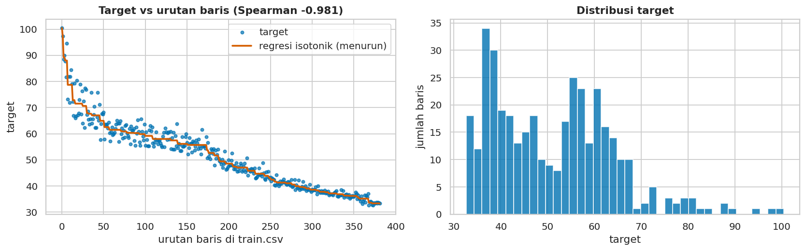
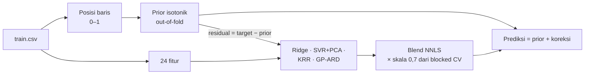
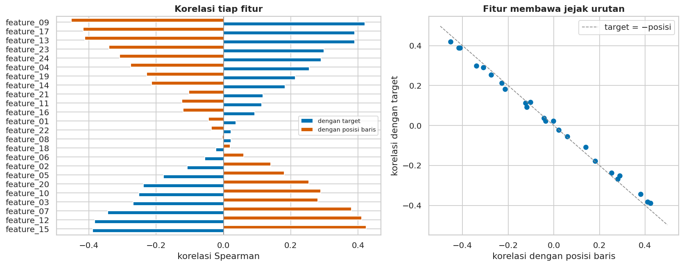
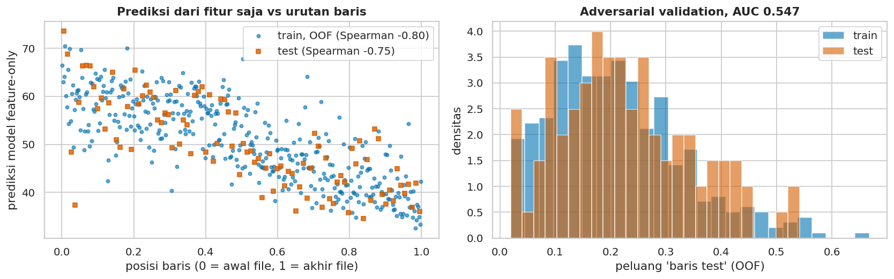
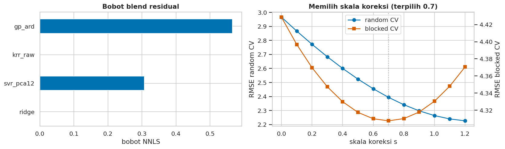
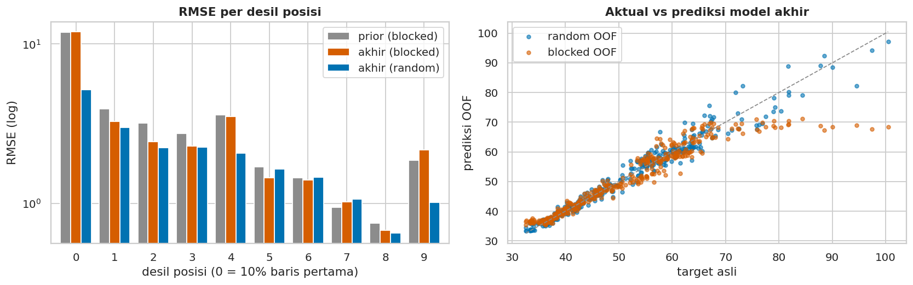
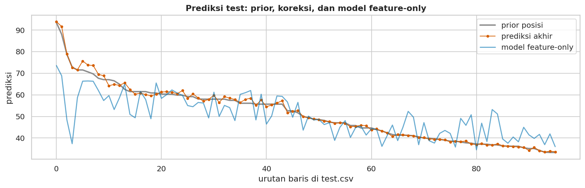

<p align="center">
  
  <br><sub>Gambar: halaman kompetisi <a href="https://www.kaggle.com/competitions/data-science-competition-fikfair2026">Data Science Competition FIK FAIR 2026</a> di Kaggle.</sub>
</p>

# Ketika Urutan Baris Lebih Informatif daripada Fitur: Prior Posisi dan Residual Learning
### FIK FAIR 2026 (UPN "Veteran" Jakarta) · Regresi 382 baris, 24 fitur anonim, metrik RMSE

**Fitur yang dianonimkan hampir tidak berkorelasi dengan target, tetapi target tersusun hampir monoton terhadap urutan baris
file. Apakah urutan itu bisa dipakai dengan aman, dan seberapa banyak yang masih bisa ditambahkan oleh 24 fitur?**

Metode di repositori ini adalah metode final tim **Lomba Terakhir Bersama Abil** (Muhammad Abil Hasan, Naufal Arkan Wahib,
Fauzan Ahsanudin Alfikri, Salsabila Rizqiyah Anwar) selama kompetisi. Versi ini mempertahankan metode dan konfigurasinya,
lalu menambahkan EDA, bukti visual untuk setiap keputusan, dan pembahasan hasil leaderboard. Hasilnya sama persis dengan
notebook tim, termasuk skor leaderboard-nya.

**Temuan utama: urutan baris menjelaskan sekitar 97% varians target (Spearman −0,981), dan korelasi setiap fitur dengan
target hanyalah cermin korelasinya dengan urutan. Prior posisi isotonik ditambah koreksi residual GP-ARD dan SVR mencapai
RMSE random CV 2,394, dibanding 8,478 untuk model tanpa posisi.**



---

## Ruang lingkup

- Eksplorasi hubungan target dengan urutan baris, korelasi fitur, dan bukti bahwa test diurutkan dengan cara yang sama.
- Dua skema validasi: random repeated CV dan blocked CV.
- Baseline rata-rata, model feature-only, dan prior posisi saja.
- Empat model residual (Ridge, SVR+PCA, Kernel Ridge, GP-ARD), blend NNLS, dan pemilihan skala koreksi.
- Diagnostik per desil posisi dan dekomposisi prediksi test.

Notebook asli tim ada di [`original/fik-fair-x-19.ipynb`](original/fik-fair-x-19.ipynb). Notebook di folder `notebooks/`
dijalankan penuh di Kaggle.

## Data dan desain eksperimen

| Data | Isi | Baris |
| --- | --- | ---: |
| `train.csv` | `record_id` acak, 24 fitur lingkungan/iklim anonim, `target` | 382 |
| `test.csv` | baris yang diprediksi (29 public, 67 private) | 96 |



Label residual di setiap fold dihitung dari prior **out-of-fold di dalam fold latih**, sehingga model residual tidak pernah
belajar dari prior yang sudah melihat targetnya sendiri.

## Cerita dari data

### 1. Fitur hanya informatif karena ikut tersusun menurut urutan



Fitur terkuat hanya berkorelasi |0,42| dengan target, sedangkan posisi baris 0,98. Korelasi fitur dengan target hampir
persis negatif korelasinya dengan posisi (korelasi antar keduanya −0,999).

### 2. Test kemungkinan diurutkan dengan cara yang sama



Model yang tidak pernah melihat posisi menghasilkan prediksi test yang menurun terhadap urutan baris test (Spearman −0,75,
di train −0,80), dan adversarial AUC train vs test hanya 0,547. Ini dasar untuk memakai prior posisi di test.

## Hasil

### Perbandingan model (RMSE)

| Model | Random CV (8 × 2) | Blocked CV (10 blok) |
| --- | ---: | ---: |
| Rata-rata target | 12,911 | 14,195 |
| Model feature-only (tanpa posisi) | 8,478 | – |
| Prior posisi saja | 2,966 | 4,429 |
| Prior + Ridge | 2,894 | 4,473 |
| Prior + Kernel Ridge | 2,460 | 4,419 |
| Prior + SVR+PCA12 | 2,441 | 4,399 |
| Prior + GP-ARD | 2,250 | 4,398 |
| **Prior + 0,7 × blend (GP-ARD 0,565, SVR 0,307)** | **2,394** | **4,308** |



Random CV terus membaik sampai skala 1,2, tetapi blocked CV mencapai minimum di 0,7. Tim memilih 0,7 agar koreksi tidak
berlebihan. Koreksi memperbaiki 7 dari 10 desil posisi pada blocked CV.

### Skor kompetisi

| Submission | Public | Private |
| --- | ---: | ---: |
| Notebook ini (late submission; identik dengan submission tim `FINAL_prior_plus_residual`, 4 Oktober 2026) | 2,2483 | 3,0814 |
| Submission tim yang terpilih otomatis (varian V3 dengan public terbaik) | 2,2129 | 3,1381 |
| Submission tim dengan private terbaik (varian stacking lain) | 2,4403 | 2,8347 |

Tim finis peringkat 4 dari 13. Public hanya 29 baris, sehingga selisih public dan private sebesar ini wajar, dan public
terbaik tidak menjamin private terbaik.

## Interpretasi



10% baris pertama memuat target tertinggi dan paling bervariasi (sampai 100), dan di sana prior maupun fitur sama-sama
gagal (RMSE blocked sekitar 12, dibanding 0,7–3,5 untuk desil lain). Jika private memuat lebih banyak baris dari awal file,
itu menjelaskan private 3,08 vs public 2,25; dugaan ini tidak bisa diverifikasi karena pembagian public/private tidak
dipublikasikan.



Prediksi akhir hampir mengikuti prior posisi; koreksi residual rata-rata hanya 0,81 poin, terbesar di 15 baris pertama.

## Menjalankan

Notebook dijalankan di Kaggle (CPU, sekitar 4 menit).

```bash
pip install -r requirements.txt kaggle
python _build_notebook.py                  # regenerasi notebook + runner dari satu sumber
kaggle kernels push -p kaggle-notebook     # notebook yang tampil di Kaggle
kaggle kernels push -p kaggle              # runner: mengeksekusi notebook dan menyimpan versi ber-output
kaggle kernels output fauzan2/fik-fair-2026-position-prior-runner -p output/
```

Data kompetisi tidak disertakan di repositori. Unduh dari halaman kompetisi ke `data/raw/` (berisi `train.csv`, `test.csv`),
lalu jalankan notebook dari folder `notebooks/`.

## Peta repositori

| Lokasi | Isi |
| --- | --- |
| `notebooks/fik-fair-2026-position-prior.ipynb` | Notebook riset lengkap dengan output |
| `original/fik-fair-x-19.ipynb` | Notebook final tim selama kompetisi |
| `src/data/load_data.py` | Load data dan posisi baris |
| `src/models/position_prior.py` | Prior isotonik out-of-fold dan blocked split |
| `src/models/residual_models.py` | Model zoo residual, CV residual, dan blend NNLS |
| `src/visualization/plots.py` | Gaya grafik dan palet ramah buta warna (Okabe–Ito) |
| `reports/figures/` | 7 grafik yang dipakai di notebook dan README |
| `reports/*.csv` | Hasil CV, pemindaian skala, dan dekomposisi prediksi test |
| `submissions/submission.csv` | Submission akhir |
| `_build_notebook.py`, `_findings.json` | Sumber tunggal notebook dan runner Kaggle, beserta teks temuan |
| `kaggle-notebook/`, `kaggle/` | Metadata kernel notebook dan runner |

## Keterbatasan

Seluruh metode bergantung pada asumsi bahwa baris test diurutkan seperti train; buktinya kuat tetapi tidak langsung. Jika
urutan tidak boleh dipakai, model feature-only (RMSE 8,48) adalah gambaran jujur dari informasi yang ada di fitur. TabPFN,
yang opsional di notebook tim, tidak dipakai karena butuh unduhan bobot; run final tim juga berjalan tanpa TabPFN.

## Tim

**Lomba Terakhir Bersama Abil**: Muhammad Abil Hasan, Naufal Arkan Wahib, Fauzan Ahsanudin Alfikri, Salsabila Rizqiyah Anwar.

Versi ini disusun ulang oleh **Fauzan Ahsanudin Alfikri** · [Kaggle: fauzan2](https://www.kaggle.com/fauzan2).

Data berasal dari kompetisi [Data Science Competition FIK FAIR 2026](https://www.kaggle.com/competitions/data-science-competition-fikfair2026)
(UPN "Veteran" Jakarta) dan hanya digunakan untuk keperluan edukasi dan portofolio.
